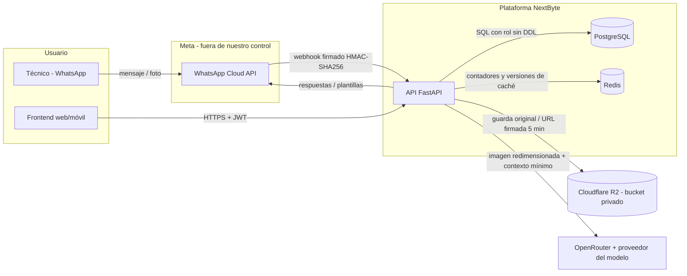

# 1. Arquitectura y flujos de datos

## Componentes

| Componente | Qué hace | Dónde corre |
|---|---|---|
| API (FastAPI, Python 3.13) | Casos de uso, reglas de negocio, seguridad | Contenedor Docker sin privilegios (usuario `app`), detrás de HTTPS |
| PostgreSQL | Fuente de verdad: usuarios, anticipos, gastos, auditoría, configuración | Recurso administrado aparte; la API usa un rol sin DDL |
| Redis | Contadores de límites de peticiones y versiones de caché | Recurso aparte; sin datos personales persistentes |
| Cloudflare R2 | Fotos y PDF de facturas (originales) | Bucket **privado**; acceso solo por URL firmada de corta duración |
| Meta WhatsApp Cloud API | Canal de mensajería con los técnicos | Servicio de Meta |
| OpenRouter → proveedor del modelo | Lectura de facturas con IA de visión | Servicio externo, con `data_collection=deny` |

La aplicación sigue **arquitectura hexagonal**: el dominio y los casos de uso no dependen de
frameworks ni de proveedores; cada integración es un adaptador detrás de un puerto. Lo verifica
`import-linter` en cada cambio (`pyproject.toml`, evidencia en `evidence/import-linter.txt`).

## Flujo de datos y fronteras de confianza

Fronteras de confianza y control en cada una:

1. **Meta → API (webhook):** se verifica la firma `X-Hub-Signature-256` sobre el cuerpo crudo; sin
   firma válida se responde 403 (`app/adapters/inbound/whatsapp/signature.py`,
   `app/adapters/inbound/http/routers/webhook.py`). Idempotencia por id de mensaje.
2. **Frontend → API:** HTTPS, JWT de 15 minutos firmado con HS256 y propósito, refresh token
   rotativo, MFA para roles con privilegios, límites de peticiones en Redis.
3. **API → IA:** la IA solo recibe la imagen redimensionada, el nombre/país/moneda de la compañía y
   los conceptos bloqueados. No recibe nombres, correos ni teléfonos de los empleados. Su respuesta
   se trata como **dato no confiable**: esquema JSON estricto y verificaciones determinísticas
   (aritmética, dígito de verificación del NIT, QR fiscal). La IA nunca ejecuta acciones.
4. **API → R2:** el bucket es privado; la API entrega URLs firmadas de corta duración solo después de
   verificar que el usuario puede ver ese gasto.

## Clasificación de datos

| Dato | Clasificación | Dónde vive | Protección |
|---|---|---|---|
| Nombre, correo, celular, BSUID de WhatsApp del empleado | Personal (Ley 1581) | PostgreSQL | Acceso por rol; logs enmascaran teléfonos |
| Contraseñas | Secreto | PostgreSQL | Argon2id (nunca reversible) |
| Semilla del MFA | Secreto | PostgreSQL | Cifrada con Fernet (`MFA_ENCRYPTION_KEY`, fuera de la BD) |
| Refresh tokens, códigos de vinculación y de recuperación | Secreto | PostgreSQL | Solo su hash con llave (HMAC-SHA256) |
| Fotos de facturas | Financiero / soporte contable | Cloudflare R2 | Bucket privado, URL firmada |
| Datos de facturas (proveedor, NIT, valores) | Financiero / fiscal | PostgreSQL | Acceso por rol y por compañía |
| Auditoría | Registro de control | PostgreSQL | Solo inserción (trigger + permisos) |
| Configuración del sistema | Operativo | PostgreSQL | Solo superadmin; cambios auditados |
